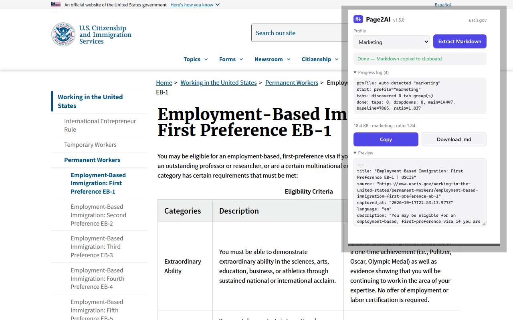

<div align="center">


# Page2AI

**Convert any webpage to clean, LLM-ready Markdown in one click.**

Browser extension for Chrome and Firefox. Built for Claude, ChatGPT, Cursor, Obsidian, and RAG pipelines. 100% local. Open source. MIT.

[](https://chromewebstore.google.com/detail/dlpaaijcnbbmlfeohlphjpnbbcnomnno)
[](https://addons.mozilla.org/en-US/firefox/addon/page2ai-webpage-to-markdown/)
[](LICENSE)
[](https://github.com/igorsaevets/page2ai-extension/actions/workflows/build.yml)
[](https://github.com/igorsaevets/page2ai-extension/stargazers)

<br>

**[Install from the Chrome Web Store](https://chromewebstore.google.com/detail/dlpaaijcnbbmlfeohlphjpnbbcnomnno)** — live since **2026-07-30** (v1.0.2, approved after a 9-day review).
Prefer to verify before trusting a README? The same anonymous check this file carried while the
listing was in review still works:

```
curl -s 'https://clients2.google.com/service/update2/crx?prodversion=140.0&acceptformat=crx2,crx3&x=id%3Ddlpaaijcnbbmlfeohlphjpnbbcnomnno%26uc'
```

<br>



</div>

---

## Works with

Any tool that reads Markdown. That covers pretty much every LLM built for developers:

- **LLMs**: Anthropic Claude, OpenAI GPT, Google Gemini, Meta Llama, xAI Grok, Mistral, Cohere
- **AI IDEs**: Cursor, GitHub Copilot, Windsurf, Zed, Continue
- **Notes**: Obsidian, Notion, Logseq, Roam, Reflect
- **Frameworks**: LangChain, LlamaIndex, Vercel AI SDK, OpenAI Agents SDK, Anthropic MCP, Haystack

## Why

Anthropic Claude, OpenAI GPT, Google Gemini, Meta Llama, Cursor: all work better with clean Markdown context. But most docs sites render dynamically. They hide code samples behind tabs (Python vs TypeScript vs cURL). They dump navigation, tracking scripts, and marketing widgets into the DOM.

Page2AI grabs the actual content. It captures hidden tabs. It outputs Markdown with a YAML frontmatter that includes OpenGraph, Twitter Card, and JSON-LD metadata. Useful for anyone building RAG pipelines, AI workflows, or knowledge bases.

## Install

Works in Chrome, Firefox, Edge, Brave, Arc, Vivaldi, and other Chromium browsers. Every surface, step by step: [install guide](https://igorsaevets.github.io/page2ai-docs/install/).

### Chrome Web Store (recommended)

**[Page2AI on the Chrome Web Store](https://chromewebstore.google.com/detail/dlpaaijcnbbmlfeohlphjpnbbcnomnno)** —
approved and live since **2026-07-30** (submitted 2026-07-21, a 9-day review). One click, and the
browser keeps it updated.

While the listing was in review, this README refused to advertise it and published an anonymous
check instead. The check stays, because a README should stay verifiable either way:

```bash
./scripts/is-published.sh
# or, without cloning:
curl -s 'https://clients2.google.com/service/update2/crx?prodversion=140.0&acceptformat=crx2,crx3&x=id%3Ddlpaaijcnbbmlfeohlphjpnbbcnomnno%26uc'
```

`status="ok"` plus a version means it is live. `error-unknownApplication` means it is not.

### Firefox Add-ons

**[Page2AI on Firefox Add-ons](https://addons.mozilla.org/en-US/firefox/addon/page2ai-webpage-to-markdown/)** —
approved and public since **2026-07-31** (first listed version: v1.3.0). Works in Firefox, Firefox Developer Edition, and Firefox Nightly.

### Install from a release

Every tagged version ships a signed-by-CI zip on the
[releases page](https://github.com/igorsaevets/page2ai-extension/releases). Download it, unzip it,
then `chrome://extensions` -> Developer mode -> Load unpacked -> select the unzipped folder.

### Build from source

```powershell
git clone https://github.com/igorsaevets/page2ai-extension.git
cd page2ai-extension
npm install
npm run build

# chrome://extensions -> Developer mode -> Load unpacked -> select .output\chrome-mv3\
```

## Usage

1. Open any webpage. Documentation, blog post, research paper, product page.
2. Hit `Alt+Shift+M` or click the toolbar icon.
3. Click **Extract**, or leave the profile on **Auto** (recommended).
4. Markdown lands in your clipboard. Paste it into Claude, ChatGPT, Cursor, or your RAG pipeline.

Progress log runs live in the popup. If you close the popup mid-extraction, the badge shows a checkmark when the result is ready. Reopen it to recover.

## Screenshots

A capture generated by running the built extension against the live site (see `scripts/gen-screenshots-real.mjs`) — the popup values (profile, chars, tabs, ratio) are what the extension actually returned on that page, not mockup numbers.

**Government long-form** — USCIS EB-1 policy manual. Regulatory PDFs and long-form pages break most extractors because the primary content sits inside deep card grids. Page2AI's article-detection heuristic finds the real body, drops the boilerplate.


## For AI Agents (MCP Server)

The Page2AI converter is also available as an [MCP server](https://modelcontextprotocol.io) for AI coding assistants: your agent reads public web pages as clean Markdown. The server fetches without cookies and runs no page scripts, so on a page behind a sign-in or one built by JavaScript its output differs from the extension's; an agent that already has the page's HTML can pass it as `html` instead. With the extension's Agent Bridge on (1.6.0; the stores still serve 1.5.1 without it), the server can instead ask your browser for such a page — see **Agent Bridge** under Features.

**Local (recommended):** add this to your MCP client config, or run `claude mcp add page2ai -- npx -y page2ai-mcp` in Claude Code:

```json
{ "mcpServers": { "page2ai": { "command": "npx", "args": ["-y", "page2ai-mcp"] } } }
```

Your machine, no cloud, Node.js 20 or later. Every client: [MCP server docs](https://igorsaevets.github.io/page2ai-docs/mcp/).

**Hosted (zero install):**

```
https://page2ai-mcp-remote.vercel.app/api/mcp
```

Point any MCP client that takes a server URL at it: public pages only, `url` only, at most 20 s per page. The same endpoint serves the [Page2AI plugin in ChatGPT](https://igorsaevets.github.io/page2ai-docs/install/#chatgpt-plugin).

**Core library** for custom pipelines:

```bash
npm install @page2ai/core
```

Source and docs: [page2ai-mcp](https://github.com/igorsaevets/page2ai-mcp) | [page2ai-core](https://github.com/igorsaevets/page2ai-core).

## Compared to other extensions

| Capability | Page2AI | Web2MD | Obsidian Web Clipper | MarkSnip | SingleFile |
|---|:---:|:---:|:---:|:---:|:---:|
| Free & open source | ✅ MIT | ❌ $9/mo Pro | ✅ | ✅ | ✅ |
| Hidden-tab code capture (Python + TS + cURL) | ✅ | ⚠️ Reddit/X only | ❌ | ❌ | N/A |
| Auto site-profile detection | ✅ 5 profiles | ⚠️ per-site rules | ❌ | ❌ | N/A |
| Client-rendered (SPA) pages | ✅ readiness gate | ❌ | ❌ | ❌ | ✅ full-page snapshot |
| Rich frontmatter (OG, Twitter, JSON-LD, article:*) | ✅ | ❌ | ⚠️ Obsidian-only | ❌ | N/A |
| Table colspan handling | ✅ | ❌ | ❌ | ❌ | N/A |
| Recursive blockquotes (bold, links, nested) | ✅ | ❌ | ⚠️ partial | ❌ | N/A |
| Quality gate + auto-fallback | ✅ | ❌ | ❌ | ❌ | N/A |
| 100% local, zero telemetry | ✅ | ❌ | ✅ | ✅ | ✅ |
| Minimum permissions (no site access at install; optional access only for the Agent Bridge) | ✅ | ❌ | ❌ | ❌ | ❌ |

Longer reads: [Webpage to Markdown Chrome extension: 6 options compared](https://igorsaevets.github.io/page2ai-docs/webpage-to-markdown-chrome-extension/) · [how Page2AI compares to other converters](https://igorsaevets.github.io/page2ai-docs/comparison/).

## Features

**Profile-aware extraction.** Auto-detects the site kind (docs, marketing, research, dashboard, WordPress marketing) and tunes strategy per profile.

**Hidden-tab code capture.** DOM-position-aware capture of tabbed panels (Python vs TypeScript vs cURL) with dedup. You get code from every tab, not just the active one.

**Only the page you see.** Page2AI converts the page in your tab and nothing else. It never swaps in the site's `llms.txt` or a Markdown copy of the page, which can be older than the page, and it makes no network request of its own. (The opt-in Agent Bridge below opens pages in background tabs at your local server's request; those pages load from their own sites, as any tab does.)

**Client-rendered page support.** Pages that build their content in the browser used to come out as an empty shell, because "the DOM stopped changing" and "the page is ready" are different questions: an empty root with a fetch in flight is perfectly quiescent. Page2AI waits for *content* instead. It samples the primary content root, requires the signal to hold still, and refuses to proceed while an `aria-busy`, `role="progressbar"` or skeleton element is still showing. An already-rendered page pays one measurement and no wait. When the gate does engage, the frontmatter says so.

**Quality gate.** Counts `<pre>` blocks vs a plain-text baseline to catch under-extraction. Falls back to permissive rendering automatically.

**Rich frontmatter YAML.** Every extraction ships with OpenGraph, Twitter Card, JSON-LD Article, `article:published`/`modified`/`author`, and canonical URL. RAG pipelines that read only the frontmatter get the full context.

**Table colspan handling.** Merged header cells expand into proper Markdown table structure.

**Recursive blockquote rendering.** Bold, links, code, nested blockquotes inside `> ...` are preserved.

**Structured-data appendix.** JSON-LD, OpenGraph, Microdata, and framework internal state (Next.js `__NEXT_DATA__`, Nuxt, Remix) get hoisted into a machine-readable appendix.

**Appendix masking (opt-in).** Inside the framework-state appendix (a page's embedded app state, such as `__NEXT_DATA__`), values matching email, phone, token and API-key patterns — and any field whose name marks it as a credential, an email, a phone or an SSN — are replaced with placeholders. There is no pattern for an SSN written out as a value, and the page's visible text is never rewritten: this keeps secrets out of the appendix, it does not anonymize a page.

**Agent Bridge (1.6.0, opt-in, off by default).** Turn its switch on in the popup and Page2AI connects to the Page2AI MCP server on your own machine (`ws://127.0.0.1:3025`), paired by a random key you paste into the server. An agent can then ask your browser for pages behind your sign-in or rendered by JavaScript; the extension opens them in background tabs and returns the same Markdown the popup makes. Turning the switch off disconnects and gives back the site access it asked for. The stores still serve 1.5.1, which has no bridge; see [PRIVACY.md](PRIVACY.md), "The Agent Bridge".

**One hotkey.** `Alt+Shift+M` opens the popup. Enter runs extraction.

## Privacy

Page2AI does not send data to the publisher or to any third party.

- No analytics. No telemetry. No crash reports.
- No publisher server. No account. No sign-in.
- Stored on your device only: your preferences, the bridge switch and its pairing key (`chrome.storage.local`), and the current tab's last result (`chrome.storage.session`, cleared when the browser closes). Bridge results are not cached.
- By itself, the extension reads only the page you explicitly acted on (`activeTab` gesture). The one opt-in exception: with the Agent Bridge switch on, it opens pages your own local MCP server names in background tabs and sends their Markdown to that process on your own machine — never to the publisher.

Full details in [PRIVACY.md](PRIVACY.md) and the [privacy policy](https://igorsaevets.github.io/page2ai-docs/privacy/).

## Permissions

| Permission | Why |
|---|---|
| `activeTab` | Access the active tab only after you click the toolbar icon or hit `Alt+Shift+M`. Not persistent. Not blanket. |
| `scripting` | Inject the extraction script into that tab. |
| `clipboardWrite` | Copy generated Markdown to your clipboard. |
| `storage` | Store your profile preference locally; cache the current tab's result in `storage.session`; hold the Agent Bridge switch and its pairing key. |
| `alarms` | Since 1.6.0: while the Agent Bridge switch is on, retry its connection to your own machine every 30 seconds. No install warning. |

No `host_permissions` in the package, and no `<all_urls>` at install: Page2AI cannot read any site until you act. Turning the Agent Bridge on asks for optional site access (`http://*/*`, `https://*/*`) for its background tabs, and turning it off removes that access; your own extractions keep working through `activeTab` either way.

## Ecosystem

Page2AI runs on and interoperates with open technical standards from the US AI developer ecosystem:

- **Chrome Extensions Manifest V3** (Google). Modern extension model.
- **[WXT framework](https://wxt.dev)** (open source, MIT). Cross-browser WebExtension framework.
- **CommonMark / GitHub Flavored Markdown**. The lingua franca of LLM context windows.
- **JSON-LD** (W3C standard). Surfaced in the frontmatter for schema-aware RAG pipelines.
- **[Model Context Protocol](https://modelcontextprotocol.io)** (Anthropic). AI agent integration via MCP server.
- **Chrome Web Store** (Google). Distribution for Chromium browsers with automated review and updates.
- **Firefox Add-ons** (Mozilla). Distribution for Firefox with automated review.
- **GitHub** (Microsoft). Code hosting, CI/CD, release automation.

Downstream consumers of Page2AI Markdown include US-based AI platforms (Anthropic Claude, OpenAI GPT, Google Gemini, Meta Llama, xAI Grok) and AI-native developer tools (Cursor, GitHub Copilot, Windsurf, Vercel AI SDK, LangChain, LlamaIndex).

See [docs/USE_CASES.md](docs/USE_CASES.md) for adoption examples and metrics.

## Architecture

```
popup (drives UX)
   -> chrome.runtime.sendMessage
background service worker (thin)
   -> chrome.scripting.executeScript
extractor.js (isolated world, on-demand)
   -> chrome.runtime.sendMessage -> background -> storage.session -> popup
result: markdown + quality report
```

- `lib/core/`: extraction library, 13 modules, ~4,300 lines of strict TypeScript. Ported from a DevTools console script (Rev-032v2) after 32 revisions of field iteration.
- `entrypoints/background.ts`: thin service worker. Injects the extractor, caches result to `storage.session` keyed by tab id.
- `entrypoints/extractor.ts`: unlisted script. Runs in the tab's isolated world. Sends progress and result via `runtime.sendMessage`.
- `entrypoints/popup/`: vanilla TypeScript + CSS, no framework. Profile selector, progress log with 300-entry ring buffer, auto-clipboard, download, cached-result recovery.

Built with [WXT](https://wxt.dev), Manifest V3, TypeScript strict.

## Contributing

Bug reports, site profile reports, and PRs welcome. See [CONTRIBUTING.md](CONTRIBUTING.md).

Development:

```powershell
npm run dev          # WXT dev server + HMR
npm run build        # Production build -> .output\chrome-mv3\
npm run compile      # tsc --noEmit type check
npm run icons        # Regenerate PNG icons from SVG sources
```

## Changelog

See [CHANGELOG.md](CHANGELOG.md) for every release. The stores carry the latest tagged one: `./scripts/is-published.sh` prints the version the Chrome Web Store serves.

## Credits

Built by [Igor Saevets](https://github.com/igorsaevets), AI Expert and Entrepreneur.

Prototype: `Sequential AI Markdown Exporter Rev-032v2`. 2,024 lines of DevTools console script, 32 revisions of field iteration. Ported to a proper extension in July 2026.

## License

MIT. See [LICENSE](LICENSE). Copyright © 2026 Igor Saevets.
