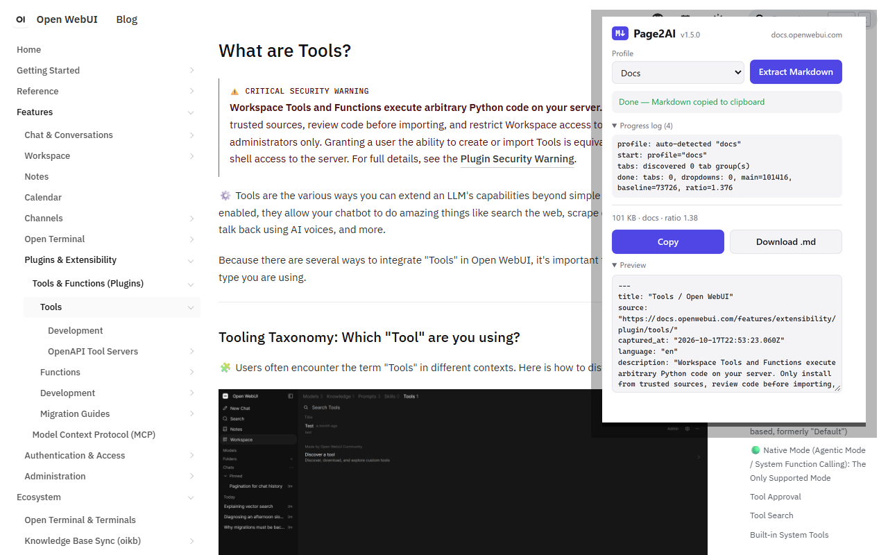
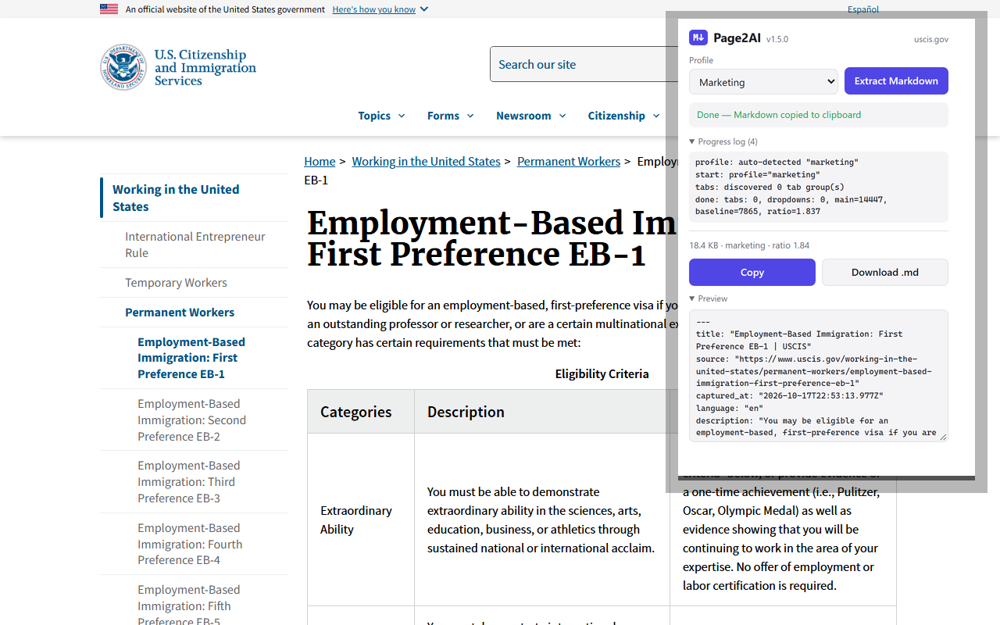

<div align="center">


# Page2AI — 网页转 Markdown

**一键把任意网页转换成干净、适合大模型（LLM）阅读的 Markdown。**

[English](README.md) · **简体中文**

免费开源的 Chrome 扩展（插件），适用于 ChatGPT、Claude、DeepSeek、Kimi、通义千问、Gemini、Cursor、Obsidian 和 RAG 知识库。
全部在浏览器本地运行：无需账号，没有服务器，没有遥测。MIT 许可证。

[](https://chromewebstore.google.com/detail/dlpaaijcnbbmlfeohlphjpnbbcnomnno)
[](LICENSE)
[](https://github.com/igorsaevets/page2ai-extension/actions/workflows/build.yml)
[](https://github.com/igorsaevets/page2ai-extension/stargazers)

**[免费添加到 Chrome](https://chromewebstore.google.com/detail/dlpaaijcnbbmlfeohlphjpnbbcnomnno)** · [文档（英文）](https://page2ai.net/) · [在线转换器](https://page2ai.net/convert/) · [给 AI 智能体用的 MCP 服务器](https://page2ai.net/mcp/)

<br>



</div>

---

## 这是什么

Page2AI 是一个浏览器扩展，能把当前标签页里的网页转换成大模型容易读懂的干净 Markdown：保留正文、标题、列表、表格、链接和代码块，去掉网站的导航栏、脚本和各种小组件。按下 `Alt+Shift+M`，Markdown 就已经复制到剪贴板，可以直接粘贴到 ChatGPT、Claude、DeepSeek、Kimi、Cursor 或 RAG 流程里，也可以保存成 `.md` 文件。

它转换的是浏览器里实际显示的页面，所以需要登录才能看的文档、由 JavaScript 渲染的单页应用（SPA）也能转换。对于分标签页展示的代码示例（Python、TypeScript、cURL），它会保留每个标签页里的代码，而不只是当前可见的那一个。

> 扩展界面目前只有英文：按钮是 **Extract Markdown**（提取 Markdown）、**Copy**（复制）和 **Download .md**（下载 .md 文件）。

## 基本信息

<div itemscope itemtype="https://schema.org/SoftwareApplication">

| | |
|---|---|
| 名称 | <span itemprop="name">Page2AI</span>（Chrome 网上应用店中的名称：Page2AI — Webpage to Markdown） |
| 类型 | <span itemprop="applicationCategory">浏览器扩展</span>，Manifest V3 |
| 功能 | <span itemprop="description">一键把任意网页转换成适合大模型阅读的干净 Markdown，全程在浏览器本地完成</span> |
| 支持的浏览器 | <span itemprop="operatingSystem">Chrome、Microsoft Edge、Brave、Arc、Vivaldi 等基于 Chromium 的浏览器</span> |
| 价格 | 免费，没有付费版，无需账号 |
| 许可证 | <a itemprop="license" href="LICENSE">MIT</a>，源代码就在本仓库 |
| 隐私 | 本地运行；没有统计分析，没有遥测，没有发布者服务器（[PRIVACY.md](PRIVACY.md)，英文） |
| 安装 | <a itemprop="installUrl" href="https://chromewebstore.google.com/detail/dlpaaijcnbbmlfeohlphjpnbbcnomnno">Chrome 网上应用店</a>（ID `dlpaaijcnbbmlfeohlphjpnbbcnomnno`），或 [Releases 中的 zip 包](https://github.com/igorsaevets/page2ai-extension/releases) |
| 网站 | <a itemprop="url" href="https://page2ai.net/">page2ai.net</a>（英文） |
| 给 AI 智能体用的同款转换器 | MCP 服务器 [`page2ai-mcp`](https://github.com/igorsaevets/page2ai-mcp) 和程序库 [`@page2ai/core`](https://github.com/igorsaevets/page2ai-core) |
| 作者 | <span itemprop="author">Igor Saevets</span> |

</div>

## 适用于

任何能读取 Markdown 的工具，几乎涵盖所有面向开发者的大模型和 AI 工具：

- **大模型**：Anthropic Claude、OpenAI GPT（ChatGPT）、Google Gemini、DeepSeek、通义千问（Qwen）、Kimi、豆包、Meta Llama、xAI Grok、Mistral
- **AI 编程工具**：Cursor、GitHub Copilot、Windsurf、Trae、Zed、Continue
- **笔记**：Obsidian、Notion、Logseq、思源笔记、语雀
- **框架与知识库**：LangChain、LlamaIndex、Dify、RAGFlow、Vercel AI SDK、OpenAI Agents SDK、MCP、Haystack

## 为什么需要它

Claude、ChatGPT、Gemini、DeepSeek、Cursor 拿到干净的 Markdown 上下文时效果更好。但多数文档网站是动态渲染的：代码示例藏在标签页里（Python、TypeScript、cURL 各一个标签），页面的 DOM 里还混着导航、跟踪脚本和营销组件。直接复制整页，得到的是一堆噪音；只复制可见部分，又会漏掉其他标签页里的代码。

Page2AI 只提取真正的内容，连隐藏标签页里的代码也一起抓取。输出的 Markdown 开头带有 YAML 前置元数据（frontmatter），包含 OpenGraph、Twitter Card 和 JSON-LD 信息。适合搭建 RAG 流程、AI 工作流或知识库的人。

## 安装

适用于 Chrome、Edge、Brave、Arc、Vivaldi 以及其他基于 Chromium 的浏览器。各种安装方式的详细步骤见 [安装指南（英文）](https://page2ai.net/install/)。

### Chrome 网上应用店（推荐）

**[在 Chrome 网上应用店安装 Page2AI](https://chromewebstore.google.com/detail/dlpaaijcnbbmlfeohlphjpnbbcnomnno)**：点一下即可安装，之后浏览器会自动更新。自 2026-07-30 起上架。

想自己确认商店当前提供的版本，可以运行：

```bash
./scripts/is-published.sh
# 或者不克隆仓库，直接：
curl -s 'https://clients2.google.com/service/update2/crx?prodversion=140.0&acceptformat=crx2,crx3&x=id%3Ddlpaaijcnbbmlfeohlphjpnbbcnomnno%26uc'
```

返回 `status="ok"` 和版本号，说明已上架；返回 `error-unknownApplication` 则说明没有。

### 打不开 Chrome 网上应用店时（例如在中国大陆）

Chrome 网上应用店在中国大陆通常无法直接访问。这时可以从本仓库安装：

1. 打开 [Releases 页面](https://github.com/igorsaevets/page2ai-extension/releases)，下载最新版本的 `page2ai-extension-<版本号>-chrome.zip`。
2. 解压到一个固定的文件夹（之后不要删除或移动它）。
3. 在地址栏打开 `chrome://extensions`（Edge 浏览器是 `edge://extensions`），打开“开发者模式”开关（Edge 中叫“开发人员模式”）。
4. 点击“加载已解压的扩展程序”（Edge 中的按钮名称略有不同），选择刚才解压出来的文件夹。

这样安装的扩展不会自动更新，有新版本时需要重新下载。请只从 Chrome 网上应用店或本仓库的 Releases 下载，不要使用来源不明的第三方 crx 下载站。

### 从源码构建

```powershell
git clone https://github.com/igorsaevets/page2ai-extension.git
cd page2ai-extension
npm install
npm run build

# chrome://extensions -> 开发者模式 -> 加载已解压的扩展程序 -> 选择 .output\chrome-mv3\
```

### Firefox

Firefox 附加组件商店里还保留着一个旧版本（1.5.1），但 Firefox 已不再支持，那个版本也不会再更新。所有新版本只发布到 Chrome 网上应用店。

## 使用方法

1. 打开任意网页：技术文档、博客文章、论文、产品页面都可以。
2. 按 `Alt+Shift+M`，或点击浏览器工具栏上的图标。
3. 点击 **Extract Markdown**，配置（Profile）保持 **Auto-detect**（自动识别）即可，推荐这样用。
4. Markdown 会自动复制到剪贴板，粘贴到 Claude、ChatGPT、DeepSeek、Cursor 或你的 RAG 流程里。点 **Download .md** 可以保存为文件。

弹窗里会实时显示处理进度。如果中途关掉了弹窗，结果准备好后图标上会出现一个对勾，重新打开弹窗就能拿到结果。

## 截图

截图来自用构建好的扩展在真实网站上运行的结果（见 `scripts/gen-screenshots-real.mjs`）：弹窗里的数值（配置、大小、标签页数、比率）都是扩展在该页面上的真实输出，不是示意图。

**技术文档**（见上图）：Open WebUI 的文档页面，带 Markdown 预览和 YAML 前置元数据。

**政府长篇页面**：一份美国政府的政策手册。长篇页面会让多数提取工具出错，因为正文藏在很深的卡片网格里。Page2AI 的正文识别会找到真正的主体内容，去掉页面模板部分。



## 给 AI 智能体用（MCP 服务器）

Page2AI 的转换器也有 [MCP 服务器](https://modelcontextprotocol.io) 版本，供 AI 编程助手使用：你的智能体可以把公开网页读成干净的 Markdown。服务器抓取网页时不带 Cookie，也不运行页面脚本，所以对于需要登录或由 JavaScript 生成的页面，它的输出会和扩展不同；如果智能体手里已经有页面的 HTML，可以直接通过 `html` 参数传入。打开扩展的 Agent Bridge（从 1.6.0 起）后，服务器还可以请你的浏览器去打开这类页面，详见下方“功能”中的 **Agent Bridge**。

**本地运行（推荐）：** 把下面的配置加到你的 MCP 客户端里，或者在 Claude Code 中运行 `claude mcp add page2ai -- npx -y page2ai-mcp`：

```json
{ "mcpServers": { "page2ai": { "command": "npx", "args": ["-y", "page2ai-mcp"] } } }
```

在你自己的电脑上运行，不经过云端，需要 Node.js 20 或更高版本。各客户端的配置方法见 [MCP 服务器文档（英文）](https://page2ai.net/mcp/)。

**托管版（免安装）：**

```
https://page2ai.igorsaevets.com/api/mcp
```

任何支持填写服务器 URL 的 MCP 客户端都可以直接使用：只能访问公开网页，只支持 `url` 和 `query` 参数，每个页面最多 60 秒。ChatGPT 中的 [Page2AI 插件](https://page2ai.net/install/#chatgpt-plugin) 仍然调用之前的地址 `https://page2ai-mcp-remote.vercel.app/api/mcp`，该地址继续可用（每个页面最多 20 秒）。

**核心程序库**，用于自建流程：

```bash
npm install @page2ai/core
```

源码与文档：[page2ai-mcp](https://github.com/igorsaevets/page2ai-mcp) | [page2ai-core](https://github.com/igorsaevets/page2ai-core)。

## 与其他扩展对比

| 能力 | Page2AI | Web2MD | Obsidian Web Clipper | MarkSnip | SingleFile |
|---|:---:|:---:|:---:|:---:|:---:|
| 免费且开源 | ✅ MIT | ❌ Pro 版 $9/月 | ✅ | ✅ | ✅ |
| 抓取隐藏标签页中的代码（Python + TS + cURL） | ✅ | ⚠️ 仅 Reddit/X | ❌ | ❌ | 不适用 |
| 自动识别网站类型 | ✅ 5 种配置 | ⚠️ 按网站规则 | ❌ | ❌ | 不适用 |
| 客户端渲染（SPA）页面 | ✅ 等待内容就绪 | ❌ | ❌ | ❌ | ✅ 整页快照 |
| 丰富的前置元数据（OG、Twitter、JSON-LD、article:*） | ✅ | ❌ | ⚠️ 仅限 Obsidian | ❌ | 不适用 |
| 表格合并单元格（colspan）处理 | ✅ | ❌ | ❌ | ❌ | 不适用 |
| 嵌套引用块（粗体、链接、多层嵌套） | ✅ | ❌ | ⚠️ 部分 | ❌ | 不适用 |
| 质量检查 + 自动回退 | ✅ | ❌ | ❌ | ❌ | 不适用 |
| 100% 本地运行，零遥测 | ✅ | ❌ | ✅ | ✅ | ✅ |
| 最小权限（安装时不能访问任何网站；只有 Agent Bridge 会申请可选权限） | ✅ | ❌ | ❌ | ❌ | ❌ |

延伸阅读（英文）：[网页转 Markdown 的 Chrome 扩展：6 种方案对比](https://page2ai.net/webpage-to-markdown-chrome-extension/) · [Page2AI 与其他转换工具的对比](https://page2ai.net/comparison/)。

## 功能

**按网站类型提取。** 自动识别网站类型（技术文档、营销页、研究论文、控制台、WordPress 营销页），并针对每种类型调整提取策略。

**抓取隐藏标签页中的代码。** 按 DOM 位置识别分标签页的代码面板（Python、TypeScript、cURL 等）并去重。你会拿到每个标签页的代码，而不只是当前激活的那一个。

**只转换你看到的页面。** Page2AI 只转换当前标签页里的页面，不做别的事。它从不拿网站的 `llms.txt` 或页面的 Markdown 副本来代替，因为它们可能比页面本身旧；它自己也不发出任何网络请求。（下面可选的 Agent Bridge 会应你本地服务器的请求在后台标签页打开页面，这些页面像普通标签页一样从各自的网站加载。）

**支持客户端渲染的页面。** 在浏览器里生成内容的页面，以前常被转换成空壳，因为“DOM 不再变化”和“页面已经准备好”是两回事：一个根节点为空、请求还在进行中的页面也是完全静止的。Page2AI 等待的是*内容*：它对主要内容区域取样，要求信号保持稳定，只要还有 `aria-busy`、`role="progressbar"` 或骨架屏元素在显示，就不会继续。已经渲染好的页面只需一次测量，不用等待。如果确实等待过，前置元数据里会注明。

**质量检查。** 对比 `<pre>` 代码块数量和纯文本基准，发现提取不完整的情况，并自动回退到更宽松的渲染方式。

**丰富的 YAML 前置元数据。** 每次提取都附带 OpenGraph、Twitter Card、JSON-LD Article、`article:published`/`modified`/`author` 和规范 URL（canonical）。只读取前置元数据的 RAG 流程也能拿到完整的上下文。

**表格合并单元格处理。** 合并的表头单元格会展开成规范的 Markdown 表格结构。

**嵌套引用块渲染。** `> ...` 里的粗体、链接、代码和多层嵌套引用都会保留。

**结构化数据附录。** JSON-LD、OpenGraph、Microdata 以及框架内部状态（Next.js `__NEXT_DATA__`、Nuxt、Remix）会被整理进一个机器可读的附录。

**附录脱敏（可选）。** 在框架状态附录（页面内嵌的应用状态，例如 `__NEXT_DATA__`）中，符合邮箱、电话、令牌和 API 密钥格式的值，以及字段名表明是凭据、邮箱、电话或社会安全号码（SSN）的字段，都会被替换成占位符。直接写成值的 SSN 没有对应的匹配规则，页面的可见文字也从不改写：这个功能是为了不让密钥进入附录，并不能把整个页面匿名化。

**Agent Bridge（从 1.6.0 起，可选，默认关闭）。** 在弹窗里打开它的开关后，Page2AI 会连接到你自己电脑上的 Page2AI MCP 服务器（`ws://127.0.0.1:3025`），用一个随机密钥配对（把密钥粘贴到服务器里）。之后智能体就可以请你的浏览器打开需要登录或由 JavaScript 渲染的页面：扩展在后台标签页打开它们，返回和弹窗一样的 Markdown。关闭开关会断开连接，并交还它申请过的网站访问权限。详见 [PRIVACY.md](PRIVACY.md)（英文）中的 “The Agent Bridge”。

**一个快捷键。** `Alt+Shift+M` 打开弹窗，按回车开始提取。

## 隐私

Page2AI 不会把数据发送给发布者或任何第三方。

- 没有统计分析，没有遥测，没有崩溃报告。
- 没有发布者服务器，无需账号，无需登录。
- 只保存在你的设备上：你的偏好设置、Agent Bridge 开关和它的配对密钥（`chrome.storage.local`），以及当前标签页的上一次结果（`chrome.storage.session`，关闭浏览器时清除）。Agent Bridge 的结果不会缓存。
- 扩展本身只读取你主动操作的那个页面（`activeTab` 手势授权）。唯一的可选例外：打开 Agent Bridge 开关后，它会在后台标签页打开你本地 MCP 服务器指定的页面，并把 Markdown 发送给你自己电脑上的这个进程，绝不会发给发布者。

完整说明见 [PRIVACY.md](PRIVACY.md) 和 [隐私政策](https://page2ai.net/privacy/)（均为英文）。

## 权限

| 权限 | 用途 |
|---|---|
| `activeTab` | 只有在你点击工具栏图标或按 `Alt+Shift+M` 之后才能访问当前标签页。不是持久权限，也不是全站权限。 |
| `scripting` | 把提取脚本注入到这个标签页。 |
| `clipboardWrite` | 把生成的 Markdown 复制到剪贴板。 |
| `storage` | 在本地保存配置偏好；在 `storage.session` 中缓存当前标签页的结果；保存 Agent Bridge 开关和配对密钥。 |
| `alarms` | 从 1.6.0 起：Agent Bridge 开关打开期间，每 30 秒重试一次与你本机的连接。安装时不会显示警告。 |

安装包里没有 `host_permissions`，安装时也没有 `<all_urls>`：在你主动操作之前，Page2AI 无法读取任何网站。打开 Agent Bridge 时，它会为后台标签页申请可选的网站访问权限（`http://*/*`、`https://*/*`），关闭时会移除该权限；无论哪种情况，你自己的提取操作都通过 `activeTab` 正常工作。

## 常见问题

### 怎么把网页转换成 Markdown，发给 ChatGPT、Claude 或 DeepSeek？

从 [Chrome 网上应用店](https://chromewebstore.google.com/detail/dlpaaijcnbbmlfeohlphjpnbbcnomnno) 安装 Page2AI，打开网页，按 `Alt+Shift+M`（或点击工具栏图标），再点 **Extract Markdown**。Markdown 会复制到剪贴板，直接粘贴到对话框里即可。点 **Download .md** 则保存为文件。

### Page2AI 免费吗？

免费。它以 MIT 许可证开源，没有付费版，也不需要账号。全部源代码都在本仓库。

### 会把网页内容或我的数据上传到服务器吗？

不会。转换在你的浏览器里完成，扩展没有自己的服务器，也没有统计分析，而且只读取你主动调用它的那个标签页。唯一的例外需要你自己打开：开启 Agent Bridge 后，它会把 Markdown 发给你自己电脑上的 Page2AI MCP 服务器。

### 需要登录的页面、由 JavaScript 渲染的页面能转换吗？

能。Page2AI 转换的是浏览器里实际显示的页面，所以你已登录的页面和单页应用都可以；对于客户端渲染的页面，它会等内容出现后再转换。Jina Reader、Firecrawl 这类服务端转换工具是从服务器而不是从你的浏览器抓取 URL，所以要转换需要登录的页面，就得把你的 Cookie 一起发给它们。

### 和 Jina Reader、Firecrawl、Crawl4AI、MarkItDown 有什么区别？

Jina Reader 和 Firecrawl 是通过 API 在服务器上抓取并转换 URL 的服务；Crawl4AI 是需要自己运行的 Python 爬虫库；MarkItDown 是微软开源的、把各种文件（PDF、Office 文档、HTML 等）转换成 Markdown 的 Python 工具。Page2AI 转换的是你已经在浏览器里打开的页面：按一个快捷键即可，不用写代码，也不需要 API 密钥。需要让程序批量处理网页时，可以用 Page2AI 的 MCP 服务器或 `@page2ai/core` 程序库。

### 代码块、表格和分标签页的代码示例能保留吗？

能。代码块保留原有的每一行，页面标明了语言时也会保留语言标记；表格保留结构（包括合并的表头单元格）；分标签页的代码示例会保留每个标签页的代码，而不只是当前可见的那一个。

### 会使用网站的 llms.txt 或 Markdown 副本吗？

不会。它只转换你标签页里的页面，因为网站的 `llms.txt` 或 `.md` 副本可能比你正在看的页面旧。

### AI 智能体能用同一个转换器吗？

能。在本地运行 MCP 服务器（`npx -y page2ai-mcp`，在 Claude Code 中是 `claude mcp add page2ai -- npx -y page2ai-mcp`），或者把 MCP 客户端指向托管地址 `https://page2ai.igorsaevets.com/api/mcp`。详见 [给 AI 智能体用](#给-ai-智能体用mcp-服务器)。

### 支持哪些浏览器？在中国大陆能用吗？

支持 Chrome、Microsoft Edge、Brave、Arc、Vivaldi 等基于 Chromium 的浏览器，不再支持 Firefox。在中国大陆可以使用：转换完全在本地进行，扩展自己不发出任何网络请求；如果打不开 Chrome 网上应用店，请按 [上面的步骤](#打不开-chrome-网上应用店时例如在中国大陆) 从 Releases 安装。

## 技术架构

```
popup（负责交互）
   -> chrome.runtime.sendMessage
background service worker（很薄的一层）
   -> chrome.scripting.executeScript
extractor.js（隔离环境，按需注入）
   -> chrome.runtime.sendMessage -> background -> storage.session -> popup
结果：markdown + 质量报告
```

- `lib/core/`：提取库，13 个模块，约 4,300 行严格模式的 TypeScript。由一个 DevTools 控制台脚本（Rev-032v2）移植而来，此前经过 32 轮实际使用中的迭代。
- `entrypoints/background.ts`：很薄的 service worker。负责注入提取脚本，并按标签页 ID 把结果缓存到 `storage.session`。
- `entrypoints/extractor.ts`：不在清单中声明的脚本，运行在标签页的隔离环境里，通过 `runtime.sendMessage` 发送进度和结果。
- `entrypoints/popup/`：原生 TypeScript + CSS，不用框架。包括配置选择、带 300 条环形缓冲的进度日志、自动复制、下载和缓存结果恢复。

使用 [WXT](https://wxt.dev)、Manifest V3 和严格模式的 TypeScript 构建。

## 参与贡献

欢迎提交 Bug 报告、网站适配问题和 PR。见 [CONTRIBUTING.md](CONTRIBUTING.md)（英文）。

开发命令：

```powershell
npm run dev          # WXT 开发服务器 + 热更新
npm run build        # 生产构建 -> .output\chrome-mv3\
npm run compile      # tsc --noEmit 类型检查
npm run icons        # 从 SVG 源文件重新生成 PNG 图标
```

## 更新日志

每个版本的变化见 [CHANGELOG.md](CHANGELOG.md)（英文）。商店提供的是最新打标签的版本：`./scripts/is-published.sh` 会打印 Chrome 网上应用店当前提供的版本号。

## 作者

由 [Igor Saevets](https://github.com/igorsaevets)（AI 专家、创业者）开发。

原型：`Sequential AI Markdown Exporter Rev-032v2`，一个 2,024 行的 DevTools 控制台脚本，经过 32 轮实际使用中的迭代，于 2026 年 7 月移植成正式的浏览器扩展。

## 许可证

MIT。见 [LICENSE](LICENSE)。Copyright © 2026 Igor Saevets.
